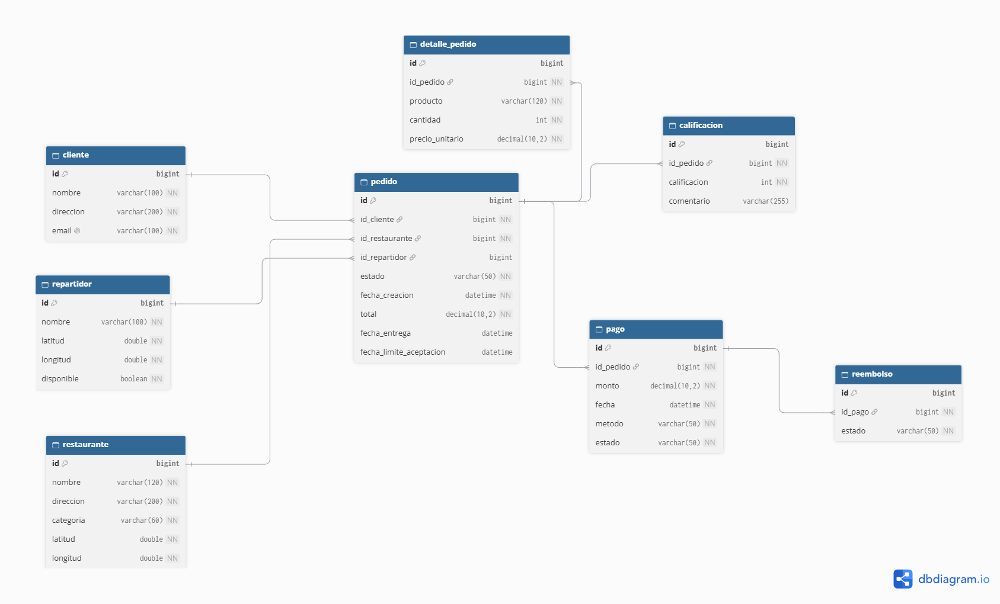
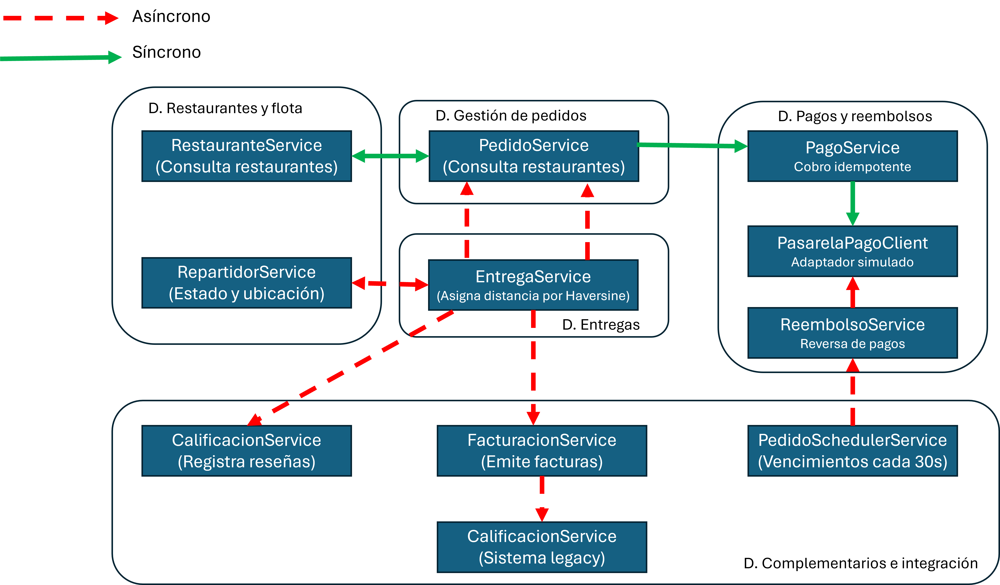

# API RapiEntrega-SOA

API REST basada en Arquitectura Orientada a Servicios (SOA) para una plataforma de delivery de alimentos y encomiendas (**RapiEntrega**): orquestación de pedidos con cálculo automático de totales en servidor, procesamiento idempotente de pagos, aceptación cronometrada por restaurantes (ventana de 5 minutos con auto-cancelación y reembolso seguro), asignación inteligente de repartidores por proximidad geográfica (fórmula de Haversine con bloqueo optimista/atómico), seguimiento de entregas en tiempo real, registro de calificaciones e integración con sistemas externos (pasarela de pagos y facturación legacy).

Desarrollada con **Spring Boot 4**, **Spring Data JPA**, **Gradle** y **MySQL**.

---

## Autor

**Gerardo Yeray Chelius Altamirano**  
7°B de Ingeniería en Sistemas Computacionales

---

## Diagrama de base de datos



---

## Diagrama de comunicación



---

## Tecnologías utilizadas

| Tecnología | Versión | Rol |
|---|---|---|
| Java | 21 | Lenguaje principal |
| Spring Boot | 4.1.2 | Framework base de desarrollo |
| Spring Data JPA | — | Capa de persistencia (ORM con Hibernate) |
| Spring Web MVC | — | API REST y controladores HTTP |
| Bean Validation | — | Validación declarativa de entidades y DTOs |
| Spring Scheduling | — | Ejecución de tareas programadas en segundo plano (Scheduler de vencimiento y conciliación) |
| MySQL | 8+ | Base de datos relacional |
| MySQL Connector/J | — | Driver JDBC oficial |
| Gradle | Wrapper | Gestión de dependencias y construcción del proyecto |

---

## Requisitos previos

- **Java 21** instalado y configurado en el `PATH`.
- **MySQL 8+** en ejecución con una base de datos llamada `rapientrega` (o la configurada en el archivo `.env`).
- **Gradle** (o utilizar el wrapper `gradlew` / `gradlew.bat` incluido en la raíz del proyecto).

---

## Variables de entorno

La aplicación carga automáticamente las credenciales y configuración de la base de datos desde un archivo `.env` ubicado en la raíz del proyecto (a través de `spring.config.import=optional:file:./.env[.properties]`).

Crea o revisa el archivo **`.env`** en la raíz del proyecto (puedes tomar como base `.env.example`):

```env
DB_URL=jdbc:mysql://localhost:3306/rapientrega?useSSL=false&allowPublicKeyRetrieval=true&serverTimezone=UTC
DB_USERNAME=tu_usuario
DB_PASSWORD=tu_contraseña
```

> **Importante:** El archivo `.env` contiene credenciales locales sensibles y **nunca** debe subirse al repositorio Git. Se encuentra protegido en el `.gitignore`.

| Variable | Descripción |
|---|---|
| `DB_URL` | Cadena de conexión JDBC hacia MySQL (base de datos `rapientrega`) |
| `DB_USERNAME` | Nombre de usuario con permisos en MySQL |
| `DB_PASSWORD` | Contraseña de acceso a MySQL |

---

## Instalación y ejecución

### 1. Clonar el repositorio

```bash
git clone https://github.com/G-Chelius-A/RapiEntrega-SOA.git
cd RapiEntrega-SOA
```

### 2. Crear la base de datos en MySQL

Accede a tu servidor MySQL y crea la base de datos:

```sql
CREATE DATABASE rapientrega CHARACTER SET utf8mb4 COLLATE utf8mb4_unicode_ci;
```

### 3. Configurar las variables de entorno

Copia la plantilla `.env.example` o genera el archivo `.env`:

```bash
# Windows (PowerShell)
Copy-Item .env.example .env

# Linux / macOS
cp .env.example .env
```

Edita `.env` con tus credenciales locales de MySQL.

### 4. Compilar y ejecutar la aplicación

**Con Gradle Wrapper:**

```bash
# Windows
.\gradlew.bat bootRun

# macOS / Linux
./gradlew bootRun
```

**Con Gradle instalado globalmente:**

```bash
gradle bootRun
```

La API se iniciará en el puerto configurado: **`http://localhost:6767`**

> **Nota:** Al inicializar, Hibernate ejecuta `spring.jpa.hibernate.ddl-auto=update`, creando o actualizando automáticamente el esquema de tablas en la base de datos `rapientrega`.

---

## Flujo principal y Arquitectura de Servicios (SOA)

El sistema aplica principios de Arquitectura Orientada a Servicios (SOA), separando responsabilidades en servicios de negocio especializados con transacciones atómicas, manejo de concurrencia y clientes para servicios externos:

1. **Gestión de Restaurantes y Repartidores**:
   - Catálogo de restaurantes categorizados por tipo de comida y con coordenadas de geolocalización (`latitud`, `longitud`).
   - Gestión de repartidores con disponibilidad activa/inactiva y actualización periódica o reactiva de posición geográfica.

2. **Registro y Validación de Pedidos (`POST /api/pedidos`)**:
   - `PedidoService` orquesta el registro comprobando la existencia de cliente y restaurante.
   - Valida ítems solicitados (cantidades mayores a cero, precios no negativos).
   - Calcula el importe total de forma estricta en el servidor para evitar manipulaciones de montos.
   - Crea el pedido en estado inicial `CREADO`.

3. **Procesamiento Idempotente del Pago (`POST /api/pedidos/{id}/pagar`)**:
   - Invocación a `PagoService`, el cual consulta pagos previos para prevenir cobros duplicados mediante idempotencia.
   - Se comunica con el cliente desacoplado `PasarelaPagoClient` (implementación de pasarela simulada con escenarios de éxito, rechazo o timeout/incertidumbre).
   - Al confirmarse el pago (`COMPLETADO`), el pedido transiciona a `PENDIENTE_ACEPTACION` y se establece la `fechaLimiteAceptacion` a exactamente **5 minutos**.

4. **Aceptación o Rechazo por Restaurante y Control de Vencimiento**:
   - **Aceptación (`POST /api/pedidos/{id}/aceptar`)**: Si el restaurante acepta dentro de los 5 minutos, se realiza una actualización condicional atómica a `ACEPTADO` y se desencadena la asignación del repartidor.
   - **Rechazo (`POST /api/pedidos/{id}/rechazar`)**: Si el restaurante rechaza, el pedido pasa a `RECHAZADO` y se solicita inmediatamente el reembolso del monto cobrado a `ReembolsoService`.
   - **Auto-cancelación programada (`PedidoSchedulerService`)**: Un proceso en segundo plano revisa periódicamente los pedidos con plazo expirado (`fechaLimiteAceptacion < now()`), cambiando condicionalmente su estado a `CANCELADO` y ejecutando de forma segura el reembolso automático al cliente.

5. **Asignación Inteligente por Cercanía Geográfica (`EntregaService`)**:
   - Para pedidos aceptados, `EntregaService` recupera los repartidores con disponibilidad activa.
   - Calcula la distancia en kilómetros hacia el restaurante mediante la fórmula de **Haversine**.
   - Reserva al repartidor más cercano empleando una actualización condicional atómica en base de datos (`updateDisponibilidadCondicional`) para prevenir condiciones de carrera y asignación doble ante solicitudes concurrentes.
   - El estado del pedido avanza a `ASIGNADO`.

6. **Ciclo de Entrega y Calificación**:
   - `POST /api/entregas/pedidos/{id}/iniciar`: Marca la salida del repartidor hacia el destino (`EN_CAMINO`).
   - `GET /api/entregas/pedidos/{id}/seguimiento`: Consulta en tiempo real las coordenadas del repartidor asignado.
   - `POST /api/entregas/pedidos/{id}/completar`: Finaliza la orden en `ENTREGADO`, registra la `fechaEntrega` y libera atómicamente al repartidor dejándolo disponible para nuevos pedidos.
   - `POST /api/calificaciones/pedidos/{pedidoId}`: Permite al cliente emitir una calificación de 1 a 5 estrellas con comentarios sobre el servicio recibido.

7. **Integración con Facturación Externa / Legacy (`FacturacionService`)**:
   - Servicio desacoplado que adapta las órdenes para emitir comprobantes fiscales contra una interfaz de facturación heredada (`FacturacionLegacyClient`).

---

## Endpoints de la API REST

Prefijo base: `http://localhost:6767`

### 1. Pedidos — `/api/pedidos`

| Método | Ruta | Descripción | Código de éxito |
|---|---|---|---|
| `POST` | `/api/pedidos` | Registra un nuevo pedido calculando el total | `201 Created` |
| `GET` | `/api/pedidos/{id}` | Consulta el detalle del pedido por su ID | `200 OK` |
| `GET` | `/api/pedidos/{id}/detalles` | Consulta los ítems y productos del pedido | `200 OK` |
| `GET` | `/api/pedidos?clienteId={id}` | Filtra pedidos realizados por un cliente | `200 OK` |
| `GET` | `/api/pedidos?restauranteId={id}` | Filtra pedidos pertenecientes a un restaurante | `200 OK` |
| `GET` | `/api/pedidos?estado={estado}` | Filtra pedidos según su estado (`CREADO`, `PENDIENTE_ACEPTACION`, etc.) | `200 OK` |
| `POST` | `/api/pedidos/{id}/pagar` | Procesa el pago e inicia la ventana de 5 minutos de aceptación | `200 OK` |
| `POST` | `/api/pedidos/{id}/aceptar` | El restaurante acepta el pedido antes del vencimiento | `200 OK` |
| `POST` | `/api/pedidos/{id}/rechazar` | El restaurante rechaza el pedido y dispara reembolso | `200 OK` |
| `POST` | `/api/pedidos/{id}/cancelar` | Cancela el pedido por vencimiento de plazo y reembolsa | `204 No Content` |

**Estados posibles de un Pedido:** `CREADO`, `PENDIENTE_PAGO`, `PENDIENTE_ACEPTACION`, `ACEPTADO`, `EN_PREPARACION`, `ASIGNADO`, `EN_CAMINO`, `ENTREGADO`, `RECHAZADO`, `CANCELADO`.

---

### 2. Entregas y Repartidores — `/api/entregas`

| Método | Ruta | Descripción | Código de éxito |
|---|---|---|---|
| `POST` | `/api/entregas/pedidos/{id}/asignar` | Asigna atómicamente el repartidor disponible más cercano (Haversine) | `200 OK` |
| `POST` | `/api/entregas/pedidos/{id}/iniciar` | Inicia el trayecto de entrega del pedido (`EN_CAMINO`) | `200 OK` |
| `POST` | `/api/entregas/pedidos/{id}/completar` | Marca el pedido como `ENTREGADO` y libera al repartidor | `200 OK` |
| `GET` | `/api/entregas/pedidos/{id}/seguimiento` | Consulta la ubicación actual del repartidor asignado al pedido | `200 OK` |
| `PATCH` | `/api/entregas/repartidores/{id}/ubicacion` | Actualiza la posición GPS (`latitud`, `longitud`) de un repartidor | `200 OK` |

---

### 3. Repartidores — `/api/repartidores`

| Método | Ruta | Descripción | Código de éxito |
|---|---|---|---|
| `GET` | `/api/repartidores` | Lista todos los repartidores registrados | `200 OK` |
| `GET` | `/api/repartidores?disponible=true` | Filtra únicamente repartidores disponibles | `200 OK` |
| `GET` | `/api/repartidores/{id}` | Consulta el perfil de un repartidor por su ID | `200 OK` |
| `PATCH` | `/api/repartidores/{id}/ubicacion` | Modifica las coordenadas (`latitud`, `longitud`) del repartidor | `200 OK` |
| `PATCH` | `/api/repartidores/{id}/disponibilidad` | Activa o desactiva la disponibilidad (`disponible=true/false`) | `200 OK` |

---

### 4. Restaurantes — `/api/restaurantes`

| Método | Ruta | Descripción | Código de éxito |
|---|---|---|---|
| `GET` | `/api/restaurantes` | Lista todos los restaurantes registrados | `200 OK` |
| `GET` | `/api/restaurantes?categoria={categoria}` | Filtra restaurantes por categoría (ej. `PIZZA`, `HAMBURGUESAS`) | `200 OK` |
| `GET` | `/api/restaurantes?nombre={nombre}` | Busca restaurantes por coincidencia de nombre | `200 OK` |
| `GET` | `/api/restaurantes/{id}` | Consulta el detalle y ubicación de un restaurante por su ID | `200 OK` |

---

### 5. Pagos — `/api/pagos`

| Método | Ruta | Descripción | Código de éxito |
|---|---|---|---|
| `GET` | `/api/pagos/{id}` | Consulta el detalle de una transacción de pago por su ID | `200 OK` |
| `GET` | `/api/pagos?pedidoId={id}` | Consulta el historial de pagos asociados a un pedido | `200 OK` |
| `GET` | `/api/pagos?estado={estado}` | Filtra pagos por estado (`PENDIENTE`, `COMPLETADO`, `RECHAZADO`, `INCIERTO`) | `200 OK` |

---

### 6. Reembolsos — `/api/reembolsos`

| Método | Ruta | Descripción | Código de éxito |
|---|---|---|---|
| `GET` | `/api/reembolsos/{id}` | Consulta el detalle de un reembolso por su ID | `200 OK` |
| `GET` | `/api/reembolsos?pagoId={id}` | Consulta el reembolso asociado a un pago específico | `200 OK` |
| `GET` | `/api/reembolsos?estado={estado}` | Filtra reembolsos por estado (`PENDIENTE`, `COMPLETADO`, `FALLIDO`) | `200 OK` |

---

### 7. Calificaciones — `/api/calificaciones`

| Método | Ruta | Descripción | Código de éxito |
|---|---|---|---|
| `POST` | `/api/calificaciones/pedidos/{pedidoId}` | Registra una calificación de 1 a 5 estrellas para un pedido | `201 Created` |
| `GET` | `/api/calificaciones/{id}` | Consulta una reseña/calificación por su ID | `200 OK` |
| `GET` | `/api/calificaciones/pedidos/{pedidoId}` | Lista las calificaciones recibidas para un pedido | `200 OK` |

---

## Ejemplos de uso de la API

### 1. Registrar un Pedido

**`POST /api/pedidos`**

```json
// Petición
{
  "clienteId": 1,
  "restauranteId": 1,
  "items": [
    {
      "producto": "Pizza Pepperoni Grande",
      "cantidad": 2,
      "precioUnitario": 189.50
    },
    {
      "producto": "Refresco 2L",
      "cantidad": 1,
      "precioUnitario": 45.00
    }
  ]
}
```

```json
// Respuesta — 201 Created
{
  "id": 1,
  "cliente": {
    "id": 1,
    "nombre": "Gerardo Yeray Chelius Altamirano",
    "direccion": "Av. Principal 123",
    "email": "gerardo.chelius@rapientrega.com"
  },
  "restaurante": {
    "id": 1,
    "nombre": "Pizzería Bella Italia",
    "direccion": "Calle 4 Norte #200",
    "categoria": "PIZZA",
    "latitud": 19.0433,
    "longitud": -98.2019
  },
  "repartidor": null,
  "estado": "CREADO",
  "fechaCreacion": "2026-10-23T15:00:00",
  "total": 424.00,
  "fechaEntrega": null,
  "fechaLimiteAceptacion": null
}
```

---

### 2. Procesar Pago del Pedido

**`POST /api/pedidos/1/pagar?metodo=TARJETA&referenciaIdempotencia=TX-CLI-001`**

```json
// Respuesta — 200 OK
{
  "id": 1,
  "estado": "PENDIENTE_ACEPTACION",
  "fechaCreacion": "2026-10-23T15:00:00",
  "total": 424.00,
  "fechaLimiteAceptacion": "2026-10-23T15:05:00"
}
```

> **Aviso:** Tras confirmarse el cobro, el pedido pasa a `PENDIENTE_ACEPTACION` y se fijan exactamente 5 minutos para que el restaurante confirme el pedido antes de la cancelación automática.

---

### 3. Aceptar Pedido y Asignar Repartidor

**`POST /api/pedidos/1/aceptar`**

```json
// Respuesta — 200 OK
{
  "id": 1,
  "estado": "ASIGNADO",
  "repartidor": {
    "id": 2,
    "nombre": "Juan Pérez",
    "telefono": "2221234567",
    "vehiculo": "MOTO",
    "latitud": 19.0440,
    "longitud": -98.2025,
    "disponible": false
  },
  "total": 424.00
}
```

---

### 4. Actualizar Coordenadas GPS del Repartidor

**`PATCH /api/repartidores/2/ubicacion?latitud=19.0450&longitud=-98.2030`**

```json
// Respuesta — 200 OK
{
  "id": 2,
  "nombre": "Juan Pérez",
  "telefono": "2221234567",
  "vehiculo": "MOTO",
  "latitud": 19.0450,
  "longitud": -98.2030,
  "disponible": false
}
```

---

### 5. Iniciar y Completar Entrega

**Iniciar Trayecto:**  
`POST /api/entregas/pedidos/1/iniciar`

```json
// Respuesta — 200 OK
{
  "id": 1,
  "estado": "EN_CAMINO"
}
```

**Completar Entrega:**  
`POST /api/entregas/pedidos/1/completar`

```json
// Respuesta — 200 OK
{
  "id": 1,
  "estado": "ENTREGADO",
  "fechaEntrega": "2026-10-23T15:35:10"
}
```

*(El repartidor queda automáticamente liberado con `disponible = true` para tomar nuevas órdenes).*

---

### 6. Calificar Servicio

**`POST /api/calificaciones/pedidos/1?calificacion=5&comentario=Excelente%20servicio%20y%20comida%20caliente`**

```json
// Respuesta — 201 Created
{
  "id": 1,
  "pedido": {
    "id": 1
  },
  "calificacion": 5,
  "comentario": "Excelente servicio y comida caliente"
}
```

---

## Manejo de códigos y errores

La aplicación centraliza la gestión de excepciones a través de `GlobalExceptionHandler`:

| Código HTTP | Significado | Ejemplos en la aplicación |
|---|---|---|
| `200 OK` | Operación exitosa | Consulta, actualización o cambio de estado de pedidos, entregas y pagos. |
| `201 Created` | Recurso creado exitosamente | Alta de pedido o registro de calificación. |
| `204 No Content` | Operación sin contenido de retorno | Cancelación por vencimiento de un pedido. |
| `400 Bad Request` | Petición incorrecta o regla de negocio infringida | `BusinessRuleException`: intentar aceptar un pedido con los 5 minutos expirados, montos negativos, cantidades inválidas o pedidos sin ítems. |
| `404 Not Found` | Recurso inexistente | `ResourceNotFoundException`: pedido, restaurante, cliente o repartidor no encontrado por su ID. |
| `500 Internal Server Error` | Error no controlado | Error de comunicación imprevisto en la base de datos o fallo interno. |

---

## Estructura del proyecto

```
src/main/java/com/api/rapientrega/
├── RapientregaApplication.java               # Punto de entrada de Spring Boot (@EnableScheduling)
├── controllers/
│   ├── CalificacionController.java           # Registro y consulta de calificaciones de pedidos
│   ├── EntregaController.java                # Asignación de repartidor, despacho y seguimiento
│   ├── GlobalExceptionHandler.java           # Manejo centralizado de excepciones y respuestas HTTP
│   ├── PagoController.java                   # Consulta de transacciones y estados de pago
│   ├── PedidoController.java                 # Ciclo de vida del pedido (creación, pago, aceptación, rechazo)
│   ├── ReembolsoController.java              # Consulta y conciliación de reembolsos
│   ├── RepartidorController.java             # Gestión de disponibilidad y geoposición de repartidores
│   └── RestauranteController.java            # Consulta de restaurantes y categorías
├── models/
│   ├── Calificacion.java                     # Entidad Calificación (pedido, puntuación 1-5, comentarios)
│   ├── Cliente.java                          # Entidad Cliente (nombre, dirección, email)
│   ├── DetallePedido.java                    # Entidad DetallePedido (producto, cantidad, precioUnitario)
│   ├── Pago.java                             # Entidad Pago (monto, fecha, método, estado)
│   ├── Pedido.java                           # Entidad Pedido (cliente, restaurante, repartidor, fechas, estados)
│   ├── Reembolso.java                        # Entidad Reembolso (pago asociado, estado)
│   ├── Repartidor.java                       # Entidad Repartidor (vehículo, coordenadas, disponibilidad)
│   └── Restaurante.java                      # Entidad Restaurante (nombre, dirección, categoría, coordenadas)
├── repositories/
│   ├── CalificacionRepository.java           # Acceso a datos de calificaciones
│   ├── ClienteRepository.java                # Acceso a datos de clientes
│   ├── DetallePedidoRepository.java          # Acceso a datos de detalles de pedido
│   ├── PagoRepository.java                   # Acceso a datos de pagos e historial por pedido
│   ├── PedidoRepository.java                 # Búsqueda de vencidos y transiciones atómicas condicionales
│   ├── ReembolsoRepository.java              # Acceso a datos de reembolsos
│   ├── RepartidorRepository.java             # Búsqueda de disponibles y reserva optimista condicional
│   └── RestauranteRepository.java            # Búsqueda por nombre y categoría de restaurante
└── services/
    ├── BusinessRuleException.java            # Excepción para validaciones y reglas de negocio
    ├── CalificacionService.java              # Lógica de registro y consulta de calificaciones
    ├── EntregaService.java                   # Cálculo geográfico Haversine y asignación de repartidores
    ├── FacturacionLegacyClient.java          # Contrato de integración con sistema de facturación 2012
    ├── FacturacionLegacyClientSimulada.java  # Implementación simulada del cliente legacy de facturación
    ├── FacturacionService.java               # Adaptador y emisión de facturas para pedidos
    ├── PagoService.java                      # Lógica de cobros con idempotencia y reembolsos
    ├── PasarelaPagoClient.java               # Contrato de integración con pasarela de pagos
    ├── PasarelaPagoClientSimulada.java       # Implementación simulada de cobros y reembolsos
    ├── PedidoSchedulerService.java           # Tarea programada para cancelación por vencimiento (5 min) y conciliación
    ├── PedidoService.java                    # Orquestador del ciclo de vida del pedido
    ├── ReembolsoService.java                 # Gestión y conciliación de reembolsos
    ├── RepartidorService.java                # Consulta y actualización de repartidores
    ├── ResourceNotFoundException.java        # Excepción para recursos no encontrados (404)
    └── RestauranteService.java               # Gestión y búsqueda de restaurantes
```

---

> DISCLAIMER: Este proyecto es una muestra representativa del caso propuesto para Arquitectura Orientada a Servicios (SOA). Incorpora patrones como desacoplamiento de servicios de negocio, clientes simulados para sistemas externos (facturación heredada y pasarela de pago), transiciones de estado condicionales para evitar condiciones de carrera, tareas programadas en segundo plano y cálculo de proximidad geográfica. Para un entorno de producción masivo, se recomienda integrar un broker de eventos distribuido (Apache Kafka o RabbitMQ), seguridad con OAuth2/JWT y contenerización mediante Docker.
